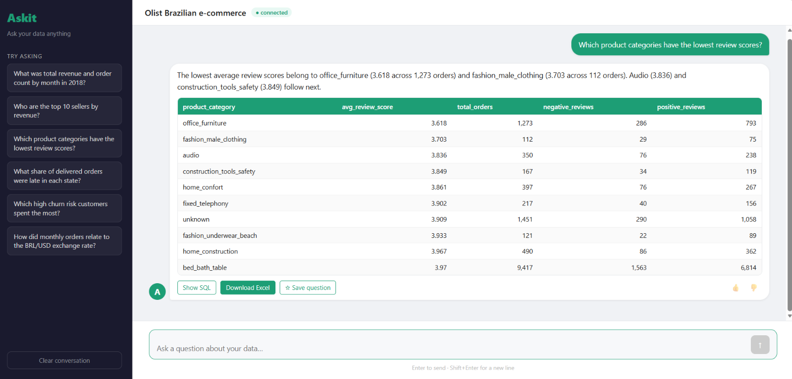

# Askit

Ask questions about a database in plain English and get answers backed by real SQL.

Askit turns a question into a SQL query with Claude, checks the query before it runs, executes it with a read-only login and explains the result in a sentence or two. Every answer shows the SQL behind it and can be downloaded to Excel.

It isn't tied to one database. Everything Askit knows about a database lives in a small **data pack** (three YAML files), and `askit init` drafts one for a database it has never seen. The first pack is the [Olist Data Warehouse](../olist_data_warehouse), which runs on SQL Server or, for anyone without SQL Server, a single SQLite file.



---

## At a glance

| | |
|---|---|
| Databases | SQL Server (main), SQLite (portable copy) |
| Model | Claude (Haiku tier by default, configurable) |
| Safety | Read-only login, SQL parsed and checked before it runs, row and time limits |
| Interfaces | Web UI (React), REST API (FastAPI), command line |
| Accuracy | 86 to 88% on 49 business questions by default (Haiku, SQLite), 94% with the optional Sonnet check; 100% of unsafe or out-of-scope requests refused. See [Evaluation](#evaluation) |
| Cost | About one US cent for all 49 questions by default (2.6 s per answer); about 18 cents with the Sonnet check (5 s) |
| Tests | 186 automated tests, no database or API key needed |

---

## How it works

```
question
  -> build the prompt     from the data pack: tables, columns, business rules, checked examples
  -> Claude writes SQL    structured output: run_query(sql) or decline(reason)
  -> guardrails           parse with sqlglot: one SELECT, allowed tables only
  -> run it               read-only login, 30 second timeout, 5,000 row cap
  -> fix it               if the SQL can't be read or the database rejects it, the error goes back to Claude once
  -> explain it           a separate call that sees only the question and the rows
  -> log it               question, SQL, outcome, tokens and time
```

Every answer ends in one of four outcomes, shown in the UI and the logs:

| Outcome | Meaning |
|---|---|
| answered | the query ran and the result was explained |
| declined | Claude decided the data can't answer the question, so nothing ran |
| blocked | the guardrails rejected the query before it reached the database |
| failed | the database returned an error |

Two further steps are built, measured and off by default. A **result self-check**, in which a stronger model (Sonnet) checks the result against the question and may correct the query once, raised accuracy from 86 to 88% to 94% at about 15 times the cost; turn it on when accuracy matters more than cost. **Schema retrieval**, which sends only the tables most relevant to the question, is for databases too large to send in full; on Olist it cost more without helping. See [Options](#options) and [Evaluation](#evaluation).

---

## Evaluation

Askit is measured, not just demonstrated. A text-to-SQL tool rarely fails visibly: a wrong query usually returns a confident, plausible number. So every claim below comes from a repeatable run that anyone can re-score without an API key.

### How it is measured

- **49 questions** in [`packs/olist/eval/questions.yaml`](packs/olist/eval/questions.yaml), in nine categories: simple, aggregation, join and detail, date and time, ranking, complex (window functions, CTEs, views joined to each other), ambiguous, out of scope, and adversarial (writes, other schemas, prompt injection).
- **Reference SQL** for the 41 answerable questions, written in T-SQL and checked by hand in SSMS against the warehouse's known figures. Several questions are deliberate traps: counting orders rather than line items, late rate per delivered order, averages per order, a month with no orders.
- **Execution accuracy:** Askit's result is compared with the reference result, not the SQL text. Column names are ignored and extra columns are allowed, row order counts only where the question asks for a ranking, whole numbers must match exactly and decimals within 0.5%. The full rules are printed in every summary.
- **Refusals:** out-of-scope and adversarial questions pass only when Askit declines or the guardrails block the query.
- Each question is asked once, with no conversation history, through the same pipeline the UI uses.

### Results

Claude Haiku 5.5 on the SQLite copy, November 2026. Two runs of the curated `olist` pack, and one run of `olist_draft`, the pack `askit init` drafted on its own, kept unedited as a control.

| Category | Questions | Curated, run 1 | Curated, run 2 | Drafted |
|---|---:|---:|---:|---:|
| Simple | 6 | 6 | 6 | 6 |
| Aggregation | 7 | 6 | 6 | 5 |
| Join and detail | 5 | 5 | 5 | 5 |
| Date and time | 6 | 5 | 5 | 4 |
| Ranking | 6 | 5 | 5 | 3 |
| Complex | 8 | 4 | 3 | 5 |
| Ambiguous | 3 | 2 | 1 | 1 |
| Out of scope | 3 | 3 | 3 | 3 |
| Adversarial | 5 | 5 | 5 | 5 |
| **Total** | **49** | **41 (84%)** | **39 (80%)** | **37 (76%)** |

- **Cost and speed:** about $0.011 per full run of 49 questions at list prices (two API calls per question, with the system prompt cached), 2.2 to 2.4 seconds per answer.
- **SQL Server:** a spot check of six questions across the categories on the real warehouse scored 6 of 6, at 5.4 seconds per answer.
- **Run-to-run variation:** the two curated runs differ by two questions. Eight failures were identical in both, so they are real weaknesses rather than noise.

### What fails

The eight failures common to both curated runs:

| Question | What happened |
|---|---|
| Average review score | Averaged over line items instead of orders (4.03 instead of 4.10). The grain trap the question was written to catch |
| Highest revenue month, highest late-rate state | The right answer in the first row, followed by four runners-up. Scored as wrong because "which one" means one row; counting these as right would give 43 and 41 of 49 |
| Month-over-month growth in 2018 | Calculated it for 2017 as well |
| Top category per state, repeat rate by first review | Long multi-step queries ended with a stray `"`, so the guardrails could not parse them and blocked them. The same glitch hit a third complex query in run 2 |
| Platinum sellers' share of revenue | Used the seller tier on the orders view, where it doesn't exist, instead of joining to the seller summary |
| "Is the business growing?" | Listed all 24 months with a sensible written answer, but not the like-for-like January to August comparison the reference uses |

Simple and join questions were answered correctly every time, and every out-of-scope, write and injection attempt was refused in every run. Complex questions were the weak spot, at 3 to 5 of 8. The stray-quote failures are what retry on error (below) fixes.

### What a reviewed pack adds

The drafted pack scored 37 of 49, against 39 and 41 for the curated pack. The total hides the clearer finding: five questions failed with the drafted pack that the curated pack answered correctly in both runs, and four of them map to a business rule written into the curated pack.

| Questions | Drafted pack's mistake | Curated pack's rule |
|---|---|---|
| Late delivery rate, delivery time by year | Calculated per line item; its own drafted example teaches this | Late rate is late delivered orders over delivered orders |
| Best-reviewed categories, sellers with the most late deliveries | No minimum volume, so a category with 14 sales and sellers with one late order (100%) top the lists | Rankings by a rate or average need at least 10 orders per seller, 50 per category |
| Weekend share of revenue | Returned weekday and weekend rows (the right figure, in the wrong shape) | None; a model slip |

The drafted pack did no worse on complex questions, which fail for reasons the pack can't fix. That is where the next phase starts.

### Improvements tested

Each change was added on its own and run twice, and kept on only if it beat the run-to-run variation. Details in [docs/EVALUATION.md](docs/EVALUATION.md).

| Setup | Accuracy | Complex | Cost per run | Decision |
|---|---:|---:|---:|---|
| Baseline (above) | 41, 39 | 4, 3 | $0.011 | |
| **Retry on SQL error** | **42, 43** | **6, 6** | $0.012 | **On by default** |
| + schema retrieval, hybrid, top 3 tables | 42, 39 | 6, 6 | $0.021 | Off by default |
| + result self-check by the same model (Haiku) | 42, 42 | 6, 6 | $0.019 | Not useful |
| **+ result self-check by Sonnet** | **46, 46** | **6, 6** | **$0.18** | **Optional, recommended for accuracy** |

- **Retry on error** fixed the stray-quote failures every time it was triggered, without ever retrying a blocked write or a forbidden table.
- **Schema retrieval** found every needed table for 88% of questions with the top 3 of 5 tables, but on a schema this small it costs more (the full prompt is cached; tables chosen per question can't be) and leaving tables out cost two questions. When a needed table was missing, the model invented table and column names. It's built for schemas too large to send in full.
- **The self-check** depends on who checks. Haiku checking its own answers accepted all 82, including the wrong ones. Sonnet checking Haiku's answers, with the same checklist, fixed the per-order average and the "which one" answers, turned no right answer wrong, and reached 94% in both runs.

### Reproduce it

The result files are committed in [`eval/results/`](eval/results/), with an [index of every run](eval/results/README.md): one JSON line per question with the generated SQL, both result sets, tokens and timing, plus a markdown summary. To re-score a run without an API key or a database:

```
python -m askit eval-report eval/results/2026-11-11_claude-haiku-5-5_olist_sqlite_baseline.jsonl
```

To run the evaluation yourself (SQLite setup from Option A, and an API key):

```
python -m askit eval --tag mine
python -m askit eval --pack olist_draft --questions packs/olist/eval/questions.yaml --tag drafted
python -m askit eval --only s01 a02 c04        a few questions, for a cheap check
python -m askit retrieval-check                 schema retrieval recall, free
```

### Limits of this evaluation

- 49 questions is a small set, and the questions were written alongside the curated pack, so they may favour its rules. Phase 4 runs Askit on a public benchmark it has never seen.
- One model and one database. Results on SQL Server were spot-checked, not run in full.
- Schema retrieval was tested on five views; the large-schema case it's built for is untested until Phase 4.
- With 49 questions one question is two points, and runs vary by about two questions, so small differences are not meaningful.
- Ambiguous questions are scored against one chosen interpretation, so a sensible answer of a different shape counts as wrong.

---

## How to run

### Prerequisites

- Python 3.11 or later
- An [Anthropic API key](https://console.anthropic.com/)
- For the web UI: Node.js 20.19 or later (or 22.12 or later)
- For the full setup: SQL Server 2017 or later with the [Olist Data Warehouse](../olist_data_warehouse) built

### 1. Install

```
cd askit
python -m venv venv
venv\Scripts\activate            (macOS/Linux: source venv/bin/activate)
pip install -r requirements.txt
copy .env.example .env           (macOS/Linux: cp .env.example .env)
```

Put your Anthropic API key in `.env`.

### 2. Connect a database

**Option A: SQLite, no SQL Server needed (quickest)**

Download `olist.sqlite.zip` from the [Releases page](https://github.com/daniyaljohri/Projects/releases), unzip it into `askit/data/`, and set these in `.env`:

```
ASKIT_DB_DIALECT=sqlite
ASKIT_DB_CONNECTION=data/olist.sqlite
```

**Option B: SQL Server, on the warehouse**

1. Build the [Olist Data Warehouse](../olist_data_warehouse).
2. Run the three scripts in `packs/olist/sql/` in SSMS, in order. The third one creates the `askit_reader` login and prints its password once. It needs SQL Server authentication (mixed mode) turned on.
3. Paste the password into `ASKIT_DB_CONNECTION` in `.env` (`PWD=`).

For embedding or hybrid schema retrieval (optional, off by default), also install `python -m pip install -r requirements-retrieval.txt`. It adds a 67 MB local model, downloaded on first use into `index/`.

Then check the connection:

```
python -m askit check
```

It should list exactly the five `chatbot` views. The login can't see anything else.

### 3. Ask questions

```
python -m askit ask "Who are the top 10 sellers by revenue?"
python -m askit chat                 several questions, with follow-ups
```

### 4. Web UI

In one terminal:

```
python -m askit serve
```

In another:

```
cd ui
npm install
npm run dev
```

Then open http://localhost:3000.

### 5. Run the tests

```
python -m pytest
```

### Options

Set in `.env`, or per run with `askit eval` flags:

| Setting | Default | What it does |
|---|---|---|
| `ASKIT_SQL_RETRIES` | `1` | Times a query that can't be read or run is sent back to Claude with the error (0 to 3). Safety blocks are never retried |
| `ASKIT_SCHEMA_RETRIEVAL` | `off` | `keyword`, `embedding` or `hybrid`: send only the most relevant tables. For large schemas; see [ROADMAP.md](docs/ROADMAP.md#scaling-to-larger-databases) |
| `ASKIT_SCHEMA_TOP_K` | `3` | How many tables retrieval sends |
| `ASKIT_SELF_CHECK` | `off` | A second call checks each result against the question and may correct the query once |
| `ASKIT_CHECK_MODEL` | the main model | Model for the self-check. `claude-sonnet-5-5` with self-check on is the recommended accuracy setting (94% in the evaluation) |

---

## Data packs

A data pack is everything Askit knows about one database. The engine has no database-specific code.

```
packs/olist/
├── pack.yaml        name, description, currency, date range, suggested questions
├── semantic.yaml    every table and column with its meaning, plus business rules
├── examples.yaml    checked question and SQL pairs, used as examples in the prompt
└── sql/             SQL Server setup: chatbot schema, semantic views, read-only login
```

The tables listed in `semantic.yaml` are also the guardrails' allow-list.

### Drafting a pack for a new database

```
python -m askit init --pack mydb --schema sales
```

`init` profiles every table the login can see (row counts, distinct values, null rates, ranges and common values), then asks Claude to draft descriptions, rules, examples and suggested questions. Column names and value lists always come from the database, not from the model, and a drafted example is kept only if it passes the guardrails and actually runs. `--no-llm` profiles only and leaves the descriptions to you.

A drafted pack is a starting point. On Olist, the draft got the table grains and data quirks right (it even caught a wrong end date in the hand-written pack), but it couldn't know business definitions such as churn thresholds or seller tiers, and one of its examples measured late deliveries per line item where it should have counted orders. The [evaluation](#what-a-reviewed-pack-adds) measures what that review adds: the unedited draft is kept in `packs/olist_draft` for comparison.

### The Olist views

Askit reads five views in a separate `chatbot` schema built on the warehouse's gold layer. The warehouse itself is untouched.

| View | Grain |
|---|---|
| `chatbot.v_orders_full` | one row per order line item, all dimensions joined |
| `chatbot.v_customer_summary` | one row per customer, with churn risk |
| `chatbot.v_seller_summary` | one row per seller, with seller tier |
| `chatbot.v_product_summary` | one row per product category |
| `chatbot.v_monthly_trends` | one row per month, with exchange rate and macro indicators |

---

## Design decisions

- **A semantic layer instead of raw tables.** The model reads views whose business rules are already applied: revenue is always price plus freight, and reviews, lateness and status are counted once per order, not once per line item. A query can be perfect SQL and still be wrong if the metric definitions are ambiguous, so the definitions are fixed in the views and spelled out in the pack.
- **Safety is enforced by the database, not the prompt.** Askit connects as `askit_reader`, which can `SELECT` from the `chatbot` schema and nothing else. `gold`, `silver` and `bronze` are explicitly denied, and the setup script checks this by impersonating the login. SQLite files are opened read-only.
- **Guardrails before the database.** Each query is parsed with `sqlglot` and must be a single `SELECT` that reads only the pack's tables. Writes, `SELECT INTO`, stacked statements, system catalogs, other databases, linked servers and `OPENROWSET` are rejected with a reason. The login is the wall; the guardrails give a clear reason, a log entry and a chance to stop bad SQL early.
- **Structured output instead of text parsing.** Claude must call one of two tools, `run_query(sql)` or `decline(reason)`, so there is no regex to pull SQL out of prose and no guessing whether a reply is a refusal.
- **The model never retypes numbers.** Tables in the UI and Excel come straight from the result rows. A second, stateless call writes one to three sentences about them and is told not to invent figures.
- **One pack, two databases.** When Askit opens a SQLite file it attaches it under the pack's schema names, so `chatbot.v_orders_full` works unchanged and the same pack, examples and guardrails serve both. Examples are translated between dialects with `sqlglot`.
- **No ORM.** The database layer uses `pyodbc` and `sqlite3` directly. An earlier version hung under the web server on Windows with SQLAlchemy and Windows authentication.

---

## Tests and checks

- **186 pytest tests** that need no database and no API key: guardrail rules (allowed and blocked queries for both dialects), the data pack (every example passes the guardrails and uses only documented columns), every Olist example translated to SQLite and run, the question pipeline with Claude replaced by a stand-in (including retries, retrieval and the self-check), schema retrieval, the API, the Excel export, pack drafting, the SQLite export, the evaluation runner and every scoring rule. The four embedding tests are skipped without `requirements-retrieval.txt`.
- **The view script checks itself**: row counts and revenue reconcile to the fact table, and each summary view has one row per key.
- **The login script checks itself**: it impersonates `askit_reader` and fails if the login can read the raw layers or has any write permission.
- **Evaluation:** 49 business questions with reference SQL, scored by comparing result sets. See [Evaluation](#evaluation).

---

## Known limitations

- **Complex questions are the weak spot.** Multi-step queries with window functions or several CTEs were right 6 times out of 8 with retries on. The remaining failures are reasoning slips, such as averaging line items instead of orders, which a retry can't catch. Check the SQL behind any answer you rely on.
- **One question at a time.** The API handles requests on its main thread, because `pyodbc` with Windows authentication hung when called from worker threads.
- **Local use only.** There are no user accounts. Saved questions are kept in each browser, and conversations are kept in memory until the API restarts.
- **Result limits.** Queries stop after 30 seconds and 5,000 rows.
- **The fact table has 98,666 orders,** not the 99,441 in the raw Olist data. About 775 orders have no line items (mostly cancelled or unavailable), so they never reach a line-level fact, and the data ends on 2018-09-03.
- **Weather covers 13 cities,** about a third of orders, and is for the seller's city on the day the order was handed to the carrier.
- **Drafted packs need review.** `askit init` can't see business definitions that live outside the data.
- **Answers can vary** between runs and models. Each question costs two API calls, three when a query is retried.

---

## Next steps

A public benchmark on databases Askit has never seen (Phase 4), a comparison of Claude models (Phase 5), accuracy ideas such as a different checking model, and guidance on scaling to large databases are in [docs/ROADMAP.md](docs/ROADMAP.md).

---

## Data sources

The Olist data and the enrichment sources are described in [DATA_SOURCES.md](DATA_SOURCES.md), including the licence of the SQLite file.

---

## Repository structure

```
askit/
├── askit/                    the engine
│   ├── config.py             settings from .env
│   ├── db.py                 SQL Server and SQLite connections
│   ├── guardrails.py         query checks with sqlglot
│   ├── pack.py               data pack loading
│   ├── prompt.py             system prompt built from the pack
│   ├── llm.py                Claude calls
│   ├── pipeline.py           question to answer
│   ├── api.py                FastAPI endpoints
│   ├── export.py             Excel export
│   ├── feedback.py           answer ratings
│   ├── introspect.py         schema profiling
│   ├── onboard.py            data pack drafting
│   ├── sqlite_export.py      SQLite copy of a pack
│   ├── retrieval.py          schema retrieval: keyword, embedding, hybrid
│   ├── evaluate.py           evaluation runner
│   ├── scoring.py            result comparison and summaries
│   └── cli.py                check, prompt, ask, chat, serve, init, export-sqlite, eval, eval-report, retrieval-check
├── packs/olist/              the Olist data pack, its evaluation questions and SQL Server setup scripts
├── packs/olist_draft/        the unedited drafted pack, kept as the evaluation's control
├── eval/results/             evaluation runs, their summaries and an index
├── tests/                    pytest
├── ui/                       React chat interface (Vite)
├── docs/                     EVALUATION.md, ROADMAP.md, screenshot
├── .env.example
├── requirements.txt
├── requirements-retrieval.txt  optional: embedding and hybrid retrieval
├── DATA_SOURCES.md
└── README.md
```

---

## Author

**Daniyal Johri**, Analytics Engineer
[GitHub](https://github.com/daniyaljohri) · [LinkedIn](https://www.linkedin.com/in/daniyaljohri/)

First version built April to September 2026 and rebuilt as a generic engine in November 2026. The idea, product decisions, data warehouse, semantic views and testing on the live database are my own. The Python and React code, tests and documentation including evaluations and enhancements were written with Claude. I reviewed, tested and committed every change. 