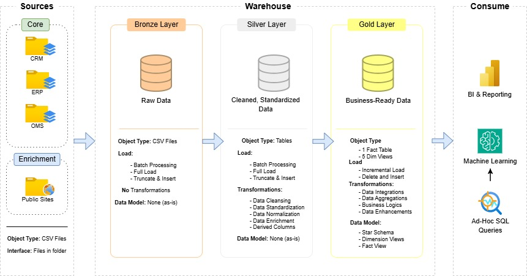
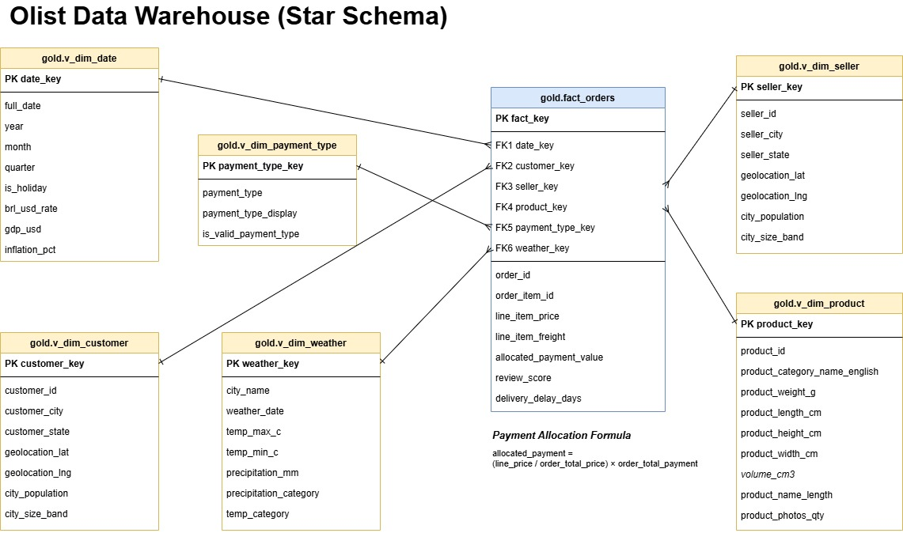
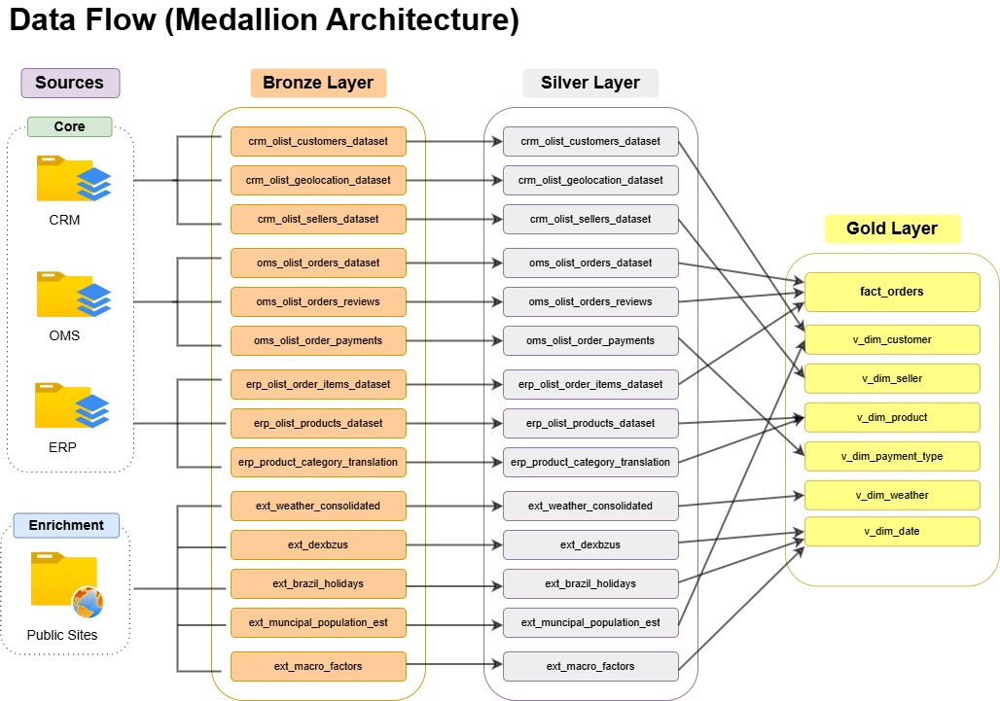

# Olist Data Warehouse

A medallion data warehouse (bronze, silver, gold) in SQL Server, built on the Brazilian Olist e-commerce dataset and enriched with five public sources: daily weather, BRL/USD exchange rates, public holidays, municipal population and national macroeconomic indicators.

The goal is to answer a question most Olist projects don't ask:

> **Do external conditions (weather, holidays, exchange rates, the economy) and seller location affect delivery performance, and through it, customer satisfaction?**

The short answer is in [Key Findings](#key-findings).



---

## At a glance

| | |
|---|---|
| Database | SQL Server 2017 or later (built on SQL Server 2025 Express) |
| Layers | Bronze (raw), Silver (cleaned and typed), Gold (star schema) |
| Gold grain | One row per order line item, 112,650 rows |
| Build time | About 30 seconds end to end |
| Quality checks | 29 automated checks, run at the end of every build |
| Languages | T-SQL only |

---

## Key Findings

Based on 95,824 delivered orders that have a review, 2016 to 2018. Overall, 6.7% arrived late and the average review is 4.16 out of 5. The queries are in [`analysis/key_findings.sql`](analysis/key_findings.sql).

### 1. Delivery time is what customers actually review

| Delivery vs estimate | Orders | Avg review | 1 or 2 star reviews |
|---|---|---|---|
| 10+ days early | 61,523 | 4.32 | 8.9% |
| 0 to 9 days early | 27,920 | 4.22 | 10.1% |
| 1 to 3 days late | 1,852 | 3.29 | 32.1% |
| 4 to 7 days late | 1,748 | 2.10 | 67.6% |
| 8+ days late | 2,781 | 1.70 | 79.3% |

Being even 1 to 3 days late triples the share of 1 or 2 star reviews. Across all orders, total delivery time and review score have a correlation of -0.33. Each of the external factors below has to be judged by how it changes delivery.

### 2. Seller location is the strongest structural driver

| Seller and customer | Orders | Avg transit days | Late | Avg review |
|---|---|---|---|---|
| Same state | 34,365 | 4.7 | 4.5% | 4.27 |
| Different state | 61,459 | 11.8 | 7.9% | 4.09 |

Two thirds of orders cross a state border. Those orders spend 2.5 times as long with the carrier and are late 75% more often.

### 3. Orders split across sellers are rated badly, even when on time

Orders fulfilled by two or more sellers average **2.86 stars with 47% at 1 or 2 stars**, against 4.17 and 12% for single-seller orders, although only 1% of them arrive late. The likely cause is split shipments arriving separately, which delay alone doesn't capture. There are only 1,261 such orders, but it's the largest effect in the data.

### 4. Rain at dispatch is linked to slower, later deliveries

Weather in the seller's city on the day the order was handed to the carrier (36,379 orders in the 13 cities with weather data):

| Rain at dispatch | Orders | Avg transit days | Late | Avg review |
|---|---|---|---|---|
| No rain | 13,011 | 7.4 | 4.3% | 4.23 |
| Drizzle (under 1 mm) | 9,370 | 8.5 | 6.3% | 4.16 |
| Light rain (1 to 10 mm) | 11,039 | 9.1 | 7.8% | 4.13 |
| Heavy rain (over 10 mm) | 2,959 | 9.3 | 7.7% | 4.11 |

Rainy dispatch days are late about 1.8 times as often as dry ones. But the amount of rain barely matters (correlation with transit days: 0.04), and Brazil's rainy season overlaps the busiest sales months. So this is an association, not proof that rain causes the delay.

### 5. Peak season hurts more than any external factor

Monthly late rates jumped to 12.3% in November 2017 (Black Friday), 14.0% in February 2018 and 18.7% in March 2018, when average reviews fell to 3.81. Across months, late rate and average review have a correlation of **-0.92**. Carrier capacity at peak times explains satisfaction better than any of the enrichment sources.

### 6. Holidays, exchange rates and the economy show no measurable effect

- **Holidays:** orders placed on a holiday were late 6.0% of the time, against 6.8% on weekdays. A holiday in the week after purchase added 0.7 days to delivery, but those orders were late slightly less often (5.1% vs 7.0%), because the estimated dates already allow for it.
- **Exchange rate:** the real weakened about 20% against the dollar between January and August 2018 (3.21 to 3.86 BRL per USD). Average basket value in reais didn't move (correlation 0.04), lateness didn't follow it (-0.11), and reviews in June to August 2018 were among the highest in the dataset.
- **Macroeconomy:** World Bank indicators are annual, which gives only 3 data points (2016 to 2018) that can't be separated from Olist's own growth. They can't be tested at this level.

### So, does it answer the business question?

**Partly, and the parts that don't hold up are a finding in their own right.** Customer satisfaction is driven almost entirely by the delivery experience. What shapes that experience is mostly **internal and structural**: where sellers are relative to customers, whether an order is split, and capacity at peak times. Of the external conditions, only **weather** shows a link, and it's confounded with seasonality. Holidays, exchange rates and annual macro data show no effect at this level of detail.

These are descriptive associations, not causal estimates. A natural next step is a model that predicts 1 or 2 star reviews from these features together, which would separate weather from seasonality.

---

## How to run

### Prerequisites

- SQL Server 2017 or later (the free Express edition works) and SSMS
- The SQL Server service account must be able to read the `datasets` folder

### 1. Get the data

The enrichment data is already in `datasets/enrichment/`. Download the Olist dataset from [Kaggle](https://www.kaggle.com/datasets/olistbr/brazilian-ecommerce) and place the 9 CSVs like this:

```
datasets/core/
├── crm/   olist_customers_dataset.csv, olist_geolocation_dataset.csv, olist_sellers_dataset.csv
├── erp/   olist_order_items_dataset.csv, olist_products_dataset.csv, product_category_name_translation.csv
└── oms/   olist_orders_dataset.csv, olist_order_payments_dataset.csv, olist_order_reviews_dataset.csv
```

### 2. Build the warehouse

Pick one of three ways.

**Option A: everything in one go (SSMS)**

1. Open `run_all.sql` and set `repo_path` to this folder, for example `C:\repos\Projects\olist_data_warehouse`. The path can't contain spaces.
2. Turn on **Query > SQLCMD Mode**.
3. Press F5.

**Option B: from the command line**

Set `repo_path` in `run_all.sql`, then run:

```
sqlcmd -S localhost\SQLEXPRESS -E -i run_all.sql
```

**Option C: one script at a time (no SQLCMD Mode needed)**

Run these in order:

1. `scripts/00_init_database.sql`
2. `scripts/bronze/01_ddl_bronze.sql`
3. `scripts/bronze/02_load_bronze.sql`
4. `scripts/silver/03_ddl_silver.sql`
5. `scripts/silver/04_load_silver.sql`
6. `scripts/gold/05_ddl_gold.sql`
7. `scripts/gold/06_load_gold.sql`

Then load the data and run the checks:

```sql
EXEC bronze.load_bronze @data_path = 'C:\repos\Projects\olist_data_warehouse\datasets\';
EXEC silver.load_silver;
EXEC gold.load_fact_orders;
```

Finally, run `tests/data_quality_checks.sql`.

### 3. Check the result

The last message should be `All data quality checks passed`.

---

## Data model



| Object | Type | Rows | Description |
|---|---|---|---|
| `gold.fact_orders` | Table | 112,650 | One row per order line: price, freight, allocated payment, review, delivery metrics |
| `gold.v_dim_date` | View | 774 | Calendar with holidays, daily BRL/USD rate and annual macro indicators |
| `gold.v_dim_customer` | View | 99,441 | Customers with coordinates, city population and size band |
| `gold.v_dim_seller` | View | 3,095 | Sellers with coordinates, city population and size band |
| `gold.v_dim_product` | View | 32,951 | Products with English category and volume |
| `gold.v_dim_payment_type` | View | 6 | Payment methods, plus an Unknown member (key -1) |
| `gold.v_dim_weather` | View | 14,248 | Daily weather for 13 cities with rain and temperature bands |



---

## Design decisions

**One SQL loader for all 14 files.** The Olist reviews contain commas and line breaks inside quoted text. `BULK INSERT` with `FORMAT = 'CSV'` (SQL Server 2017+) parses these correctly, as long as the row terminator matches each file. The reviews, translation and enrichment files end their lines with CRLF and the rest with LF. Getting that right removed the need for any Python preprocessing.

**Deferred typing.** Columns that arrive in awkward formats stay as text in bronze: FRED dates are `DD/MM/YYYY` with blank rates, and IBGE population looks like `"22,728"` or `43.935(2)`. They're cast in silver, so bronze stays an exact copy of the source and the load never fails on a bad value.

**Forward-filling exchange rates.** FRED has no rates for weekends or US holidays. Silver builds a full calendar and carries the last known rate forward. `COUNT(rate) OVER (ORDER BY date)` only increases on days that have a rate, so it groups each gap with the rate before it, and `MAX() OVER (PARTITION BY group)` fills the gap. Using a running `MAX()` alone would carry forward the highest rate so far, not the latest one. Filled days are flagged with `is_forward_filled`.

**Allocated payments.** Orders can be split across several payment methods and several items. Each line gets its share of what the customer actually paid: `line price / order total price × order total payment`. This way, payment totals never double-count. A quality check confirms that the allocations add back up for every order.

**Unknown member.** Three order lines have no payment record. Rather than dropping them, or pointing them at a key that doesn't exist, they map to an Unknown payment type with key -1.

**Weather join.** Weather is matched on the seller's city and the date the order was handed to the carrier. That's where and when the shipment starts moving. It matches 37% of order lines, because weather was downloaded for the 13 largest cities only.

**MERGE fact load.** `gold.load_fact_orders` updates changed rows, inserts new ones and deletes rows that left silver, so `fact_key` values stay stable between runs.

---

## Data quality

`tests/data_quality_checks.sql` runs 29 checks after every build:

- **Silver:**
  - row counts match bronze
  - geolocation has one row per zip code
  - order IDs are unique
  - the FX calendar has no gaps and no missing rates
  - population parsed for every municipality
- **Gold:**
  - dimension keys are unique
  - one fact row per order line
  - the fact grain is unique
  - every fact key exists in its dimension
  - allocated payments match what was paid
  - review scores are 1 to 5

Checks are either **errors** (pipeline bugs, which fail the build) or **warnings** (known gaps in the source data, which are reported only). The one current warning: Olist marks 8 orders as delivered without a delivery date.

---

## Data sources

| Source | Used for |
|---|---|
| [Olist on Kaggle](https://www.kaggle.com/datasets/olistbr/brazilian-ecommerce) | Orders, items, customers, sellers, products, payments, reviews, geolocation |
| [Open-Meteo](https://open-meteo.com/) | Daily weather for 13 cities |
| [FRED DEXBZUS](https://fred.stlouisfed.org/series/DEXBZUS) | Daily BRL/USD exchange rate |
| [World Bank](https://data.worldbank.org/country/brazil) | GDP, inflation, unemployment, GDP per capita |
| [IBGE](https://www.ibge.gov.br/estatisticas/sociais/populacao/9103-estimativas-de-populacao.html) | Municipal population estimates |
| [Nager.Date](https://date.nager.at/) | Brazilian public holidays |

Licences, coverage and citations are in [DATA_SOURCES.md](DATA_SOURCES.md).

---

## Repository structure

```
olist_data_warehouse/
├── run_all.sql                    builds everything and runs the checks
├── scripts/
│   ├── 00_init_database.sql
│   ├── bronze/                    01_ddl_bronze.sql, 02_load_bronze.sql
│   ├── silver/                    03_ddl_silver.sql, 04_load_silver.sql
│   └── gold/                      05_ddl_gold.sql, 06_load_gold.sql
├── tests/
│   └── data_quality_checks.sql
├── analysis/
│   └── key_findings.sql
├── datasets/
│   ├── enrichment/                committed snapshot
│   └── core/                      Olist CSVs from Kaggle (not committed)
├── docs/                          architecture, data flow and star schema diagrams
├── DATA_SOURCES.md
└── README.md
```

---

## Author

**Daniyal Johri**, Analytics Engineer
[GitHub](https://github.com/daniyaljohri) · [LinkedIn](https://www.linkedin.com/in/daniyaljohri/)

Originally built March to May 2026 and restructured for reproducibility in October 2026. The original design and SQL are my own. Restructuring, tests, and documentation were assisted by Claude.
